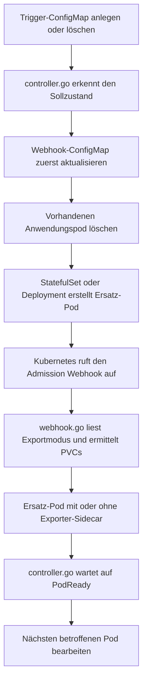

<!-- Technische Erklärung der Dateien, Schnittstellen und Abläufe des V3-Exporter-PoC. -->

# Die Dateien des V3-Exporter-PoC erklärt

Dieses Dokument erklärt die Implementierung des PoC im Repository
`ces-exporter`. Es beschreibt für jede neu angelegte oder für den PoC angepasste
Datei ihre Aufgabe, die wichtigsten Funktionen und das Zusammenspiel mit den
anderen Dateien. Anschließend werden bereits vorhandene Dateien erklärt, auf
deren Infrastruktur der PoC aufsetzt.

Die Anleitung zum Installieren und Ausführen sowie die protokollierte Abnahme
stehen in [poc_v3_exporter_de.md](poc_v3_exporter_de.md). Dieses Dokument erklärt
vor allem, **wie der Code arbeitet und weshalb die Dateien benötigt werden**.

## 1. Was der PoC insgesamt macht

Der CES-Exporter erhält zwei zusätzliche Aufgaben: Ein Controller erkennt den
gewünschten Exportmodus und ersetzt die betroffenen Anwendungspods. Ein
Admission Webhook ergänzt bei der Erstellung der Ersatz-Pods einen
Exporter-Container. Beide Aufgaben laufen im selben CES-Exporter-Prozess.
Der Exporter-Container in einem Anwendungspod ist dagegen ein eigener Container
mit dem Image `registry.cloudogu.com/k8s/rsync-sidecar:1.1.2`.

Damit gibt es zwei unterschiedliche Bedeutungen von „Exporter“:

| Bestandteil | Aufgabe |
| --- | --- |
| CES-Exporter als Deployment | Führt die bestehende HTTP-API sowie den neuen Controller und Admission Webhook aus. |
| Exporter-Sidecar im Anwendungspod | Mountet die ausgewählten PVCs schreibgeschützt und startet einen SSH-Server. |

Der Controller mountet selbst keine Anwendungsdaten. Der Webhook verschiebt
keine Daten. Das Lesen findet im Sidecar statt. Eine Migration und der
SSH-Datentransfer zum Zielsystem sind nicht Teil dieses PoC.



Der gemeinsame Teil `discovery.go` ermittelt dabei für Controller und Webhook,
welche Workloads zu V3-Dogus gehören und welche ihrer PVCs berücksichtigt werden.

## 2. Dateiübersicht

Alle Links sind relativ zu dieser Dokumentationsdatei.

| Datei | Rolle | Neu oder angepasst |
| --- | --- | --- |
| [poc_requirements.md](../../poc_requirements.md) | Anforderungen und Abnahmekriterien | Im PoC-Verlauf ergänzt |
| [core/config.go](../../core/config.go) | Liest die PoC-Konfiguration aus Umgebungsvariablen | Angepasst |
| [server.go](../../server.go) | Startet die zusätzliche PoC-Laufzeit im bestehenden Exporter | Angepasst |
| [exportpoc/runtime.go](../../exportpoc/runtime.go) | Kubernetes-Clients, TLS-Server und Lebenszyklus | Neu |
| [exportpoc/controller.go](../../exportpoc/controller.go) | Exportmodus und sequenzielle Pod-Ersetzung | Neu |
| [exportpoc/discovery.go](../../exportpoc/discovery.go) | V3-Zuordnung und Auswahl der PVCs | Neu |
| [exportpoc/webhook.go](../../exportpoc/webhook.go) | Admission-Anfragen und Sidecar-Injektion | Neu |
| [exportpoc/poc_test.go](../../exportpoc/poc_test.go) | Automatisierte Tests mit simuliertem Kubernetes | Neu |
| [k8s/helm/values.yaml](../../k8s/helm/values.yaml) | Helm-Schalter und Sidecar-Image | Angepasst |
| [k8s/helm/templates/deployment.yaml](../../k8s/helm/templates/deployment.yaml) | Ports, Umgebungsvariablen, TLS-Mount und Probe des Exporters | Angepasst |
| [k8s/helm/templates/poc.yaml](../../k8s/helm/templates/poc.yaml) | Zertifikate, Webhook-Registrierung, Service, Berechtigungen und Netzwerkfreigabe | Neu |
| [k8s/poc/dogus.yaml](../../k8s/poc/dogus.yaml) | Testobjekt Nexus mit mitgeliefertem PostgreSQL | Neu |
| [docs/development/poc_v3_exporter_de.md](poc_v3_exporter_de.md) | Installationsanleitung, manueller Prüfablauf und Abnahme | Neu |
| [docs/development/poc_v3_dateien_de.md](poc_v3_dateien_de.md) | Diese Erklärung der Dateien und ihrer Zusammenarbeit | Neu |

## 3. Anforderungen: `poc_requirements.md`

Diese Datei legt fest, was der PoC nachweisen muss. Sie ist keine
Laufzeitkonfiguration und wird vom Programm nicht eingelesen.

Sie beschreibt insbesondere die getrennte Steuerung durch zwei ConfigMaps,
die automatische Pod-Ersetzung und das schreibgeschützte Einbinden der PVCs.
Außerdem legt sie die Reihenfolge fest: Erst muss der Webhook den gewünschten
Exportmodus erkennen können, anschließend dürfen die Anwendungspods ersetzt
werden.

Als Testobjekt ist Nexus `3.96.4-2` als V3-Dogu festgelegt. PostgreSQL wird vom
Nexus-Chart als eigener StatefulSet mitgeliefert. Beide Workloads gehören zur
selben Dogu-CR. Für den Test ist deshalb keine zusätzliche PostgreSQL-Dogu-CR
vorgesehen.

Die Datei grenzt den Nachweis ein: Es genügt ein manueller erfolgreicher
Durchlauf mit Lesen einer Datei pro relevantem PVC. Eine vollständige Migration,
ein SSH-Transfer und der Nachweis aller denkbaren Workload- oder
Fehlerkonstellationen gehören nicht zur Abnahme.

ADR 0067 im benachbarten Repository `k8s-ecosystem-architecture` liefert den
Architekturkontext. Die PoC-Anforderungen konkretisieren den hier umgesetzten
Ausschnitt.

## 4. Konfiguration: `core/config.go`

Diese vorhandene Datei enthält die zentrale Konfiguration des CES-Exporters.
`ReadConfigFromEnv()` liest Umgebungsvariablen und überführt sie in die
Go-Struktur `Configuration`. Für den PoC wurden zusätzliche Felder ergänzt.

| Umgebungsvariable | Go-Feld | Standardwert oder Bedeutung |
| --- | --- | --- |
| `POC_ENABLED` | `PoCEnabled` | Nur der exakte Wert `true` aktiviert den PoC. |
| `POC_SIDECAR_IMAGE` | `PoCSidecarImage` | `registry.cloudogu.com/k8s/rsync-sidecar:1.1.2` |
| `POC_PUBLIC_KEY_CONFIGMAP` | `PoCPublicKeyConfigMap` | `ces-importer-public-key` |
| `POC_PUBLIC_KEY_DATA_KEY` | `PoCPublicKeyDataKey` | `publicKey` |
| `POC_CERT_DIR` | `PoCCertDir` | `/etc/ces-exporter-webhook` |
| `POC_WEBHOOK_NAME` | `PoCWebhookName` | `ces-exporter-poc`; Helm setzt den tatsächlichen Namen einschließlich Namespace. |

Die Hilfsfunktion `envOrDefault()` gibt den Inhalt einer nicht leeren
Umgebungsvariable zurück. Fehlt sie oder ist ihr Wert leer, wird der angegebene
Standardwert verwendet.

Der Namespace stammt weiterhin aus `NAMESPACE`. Die Helm-Vorlage bezieht ihn
über die Kubernetes Downward API aus dem Namespace des Exporter-Pods. Auch
`API_KEY` bleibt für den Multinode-Exporter erforderlich, weil dessen bisherige
HTTP-API weiterhin gestartet wird.

Diese Datei startet keine Controller und kommuniziert nicht mit Kubernetes.
Sie liefert die Einstellungen, die `server.go` beim Start verwendet.

## 5. Einbindung in das Programm: `server.go`

`server.go` verbindet die vorhandene Exporter-Anwendung mit dem neuen Paket
`exportpoc`.

In `run()` wird geprüft, ob der PoC aktiviert ist und der Exporter im
Multinode-Modus läuft. Nur dann wird die Kubernetes-Verbindungskonfiguration
ermittelt und eine neue `exportpoc.Runtime` angelegt. Die zentralen
PoC-Einstellungen werden dabei aus `core.Configuration` in
`exportpoc.Config` übertragen.

`Runtime.Run()` startet in einer eigenen Goroutine. Dadurch können der neue
TLS-Webhook und die bestehende HTTP-API gleichzeitig laufen. Der Webhook
verwendet Port `9443`, die vorhandene API weiterhin Port `8080`.

Beide erhalten denselben Abbruchkontext. `SIGINT`, `SIGTERM` oder ein Abbruch
über diesen Kontext leiten das Herunterfahren ein. Ein zurückgegebener Fehler
der PoC-Laufzeit wird protokolliert und löst ebenfalls den gemeinsamen Abbruch
aus.

Die bestehenden API-Routen werden weiterhin in `createEndpoints()` angelegt.
Für den PoC wurden dort keine neuen HTTP-Endpunkte ergänzt. Insbesondere wird
der ConfigMap-Trigger nicht über die bisherigen `/export/...`-Routen gesteuert.

## 6. Laufzeit und TLS: `exportpoc/runtime.go`

Diese Datei baut die Infrastruktur auf, in der Controller und Webhook laufen.
Die Struktur `Config` enthält ihre Einstellungen, `Runtime` hält diese
Konfiguration und die gemeinsam verwendete Ressourcenermittlung.

### `New()` – Kubernetes-Zugriff vorbereiten

`New()` kopiert die übergebene Kubernetes-Verbindungskonfiguration und begrenzt
die Dauer einzelner API-Anfragen auf 15 Sekunden. Anschließend erstellt die
Funktion zwei Clients:

- Einen typisierten Kubernetes-Client für bekannte Ressourcen wie Pods,
  ConfigMaps, Deployments, StatefulSets und Secrets.
- Einen dynamischen Client für die V3-Dogu-CRs. Er liest diese als
  unstrukturierte Ressourcen und benötigt dafür keine Umstellung der
  bestehenden typisierten V2-Dogu-Anbindung des Exporters.

Beide Clients werden in der gemeinsamen `discovery`-Struktur hinterlegt.
Ist kein Zeitlimit für Pod-Ersetzungen angegeben, gilt ein Standardwert von
zehn Minuten. Dieses Zeitlimit ist derzeit eine Einstellung der
`exportpoc.Config`; dafür existiert keine eigene Helm- oder Umgebungsvariable.

### `Run()` – Webhook und Controller betreiben

`Run()` wartet zunächst darauf, dass sich `tls.crt` und `tls.key` aus dem
konfigurierten Zertifikatsverzeichnis laden lassen. Bei einem Fehler versucht
sie es nach zwei Sekunden erneut; ein Abbruchkontext beendet auch dieses
Warten.

Danach öffnet sie den Listener auf Port `9443`. Der HTTPS-Server hat zwei Pfade:

| Pfad | Aufgabe |
| --- | --- |
| `/mutate-pods` | Verarbeitet die Admission-Anfragen des Kubernetes-API-Servers. |
| `/readyz` | Gibt HTTP 200 zurück, sobald der Webhook-Server Anfragen verarbeitet. |

TLS verwendet mindestens Version 1.2. Bei einem TLS-Handshake werden die
Zertifikatsdateien erneut geladen, damit eine Erneuerung durch cert-manager
übernommen werden kann. Schlägt das Laden fehl, verwendet der Code das beim
Start geladene Zertifikat.

Der Controller läuft parallel zum HTTPS-Server. Bei einem Abbruch wird der
Server mit einem eigenen Zeitlimit von fünf Sekunden heruntergefahren.

`/readyz` prüft die Erreichbarkeit des Webhook-Servers. Es prüft nicht, ob ein
Exportmodus-Wechsel abgeschlossen ist. Dieser Bearbeitungsstand steht in der
Webhook-ConfigMap.

## 7. Steuerung und Pod-Ersetzung: `exportpoc/controller.go`

Diese Datei ist für die aktive Veränderung des Clusters zuständig. Sie setzt
den Modus für den Webhook und löscht die zu ersetzenden Pods. Das Erzeugen der
neuen Pods übernehmen anschließend deren bestehende Kubernetes-Controller.

### Sollzustand und Bearbeitungszyklus

`desired()` liest die Trigger-ConfigMap `ces-exporter-export-mode`.
Existiert sie, ist der gewünschte Exportmodus aktiv. Fehlt sie, ist er inaktiv.
Andere Lesefehler werden als Fehler behandelt.

Bei Aktivierung verwendet die Funktion die Kubernetes-UID dieser ConfigMap als
Kennung des Vorgangs. Wird die ConfigMap gelöscht und erneut angelegt, erhält
sie eine neue UID. So kann der Controller eine neue Aktivierung von einem
bereits bearbeiteten oder fehlgeschlagenen Vorgang unterscheiden. Für den
inaktiven Zustand verwendet er die Kennung `inactive`.

`control()` führt den Abgleich direkt nach dem Start und danach in einer
Schleife mit einem Zwei-Sekunden-Ticker aus. Die Implementierung fragt den
Zustand regelmäßig ab; sie verwendet keinen Kubernetes-Watch auf die
ConfigMap. Ein laufender Abgleich wird innerhalb dieser Laufzeit nicht durch
einen zweiten parallelen Abgleich überholt.

### Webhook vor Pod-Ersetzungen prüfen

`registrationReady()` liest die erwartete `MutatingWebhookConfiguration`.
Sie sucht einen Webhook mit passendem Namespace, dem Pfad `/mutate-pods`,
einem nicht leeren CA-Bundle und `failurePolicy: Ignore`.

Zusätzlich liest sie die EndpointSlices des referenzierten Service und verlangt
mindestens einen als bereit markierten Endpunkt mit einer Adresse. Erst nach
dieser Prüfung darf der eigentliche Abgleich Pods ersetzen. Damit werden Pods
nicht bereits während des Aufbaus der Webhook-Infrastruktur neu gestartet.

### Die Zustands-ConfigMap verwalten

`reconcile()` verbindet die einzelnen Schritte. Sie liest den Sollzustand,
prüft die Webhook-Infrastruktur und legt bei Bedarf die ConfigMap
`ces-exporter-webhook-config` an.

Diese enthält folgende Datenfelder:

| Feld | Bedeutung |
| --- | --- |
| `exportMode` | Gewünschter Modus als String `true` oder `false`; dieses Feld liest der Webhook. |
| `transition` | UID der aktiven Trigger-ConfigMap oder `inactive`. |
| `phase` | `reconciling`, `ready` oder `failed`. |
| `error` | Fehlerbeschreibung bei einem fehlgeschlagenen Vorgang. |

Bei einem neuen Vorgang schreibt der Controller zuerst den gewünschten
`exportMode` in diese ConfigMap. Erst nach erfolgreichem Schreiben ruft er
`replacePods()` auf. Der Webhook liest die ConfigMap ohne lokalen Cache direkt
aus der Kubernetes-API. Damit ist der neue Wert vor den durch den Controller
ausgelösten Pod-Erstellungen verfügbar.

Nach erfolgreicher Bearbeitung wird die Phase `ready` gesetzt. Bei einem Fehler
werden `failed` und die Fehlerbeschreibung gespeichert; zusätzlich entsteht
ein Kubernetes-Warning-Event. Ein fehlgeschlagener Vorgang mit unveränderter
Kennung wird bei späteren Abgleichen nicht nochmals ausgeführt. Diese Sperre
liegt in der ConfigMap und bleibt deshalb auch nach einem Exporter-Neustart
erhalten.

Ein bereits als bereit gespeicherter Zustand wird weiter überprüft. Solange
alles passt, schreibt der Controller die ConfigMap dabei nicht ständig neu.

### Pods auswählen und nacheinander ersetzen

`replacePods()` prüft bei Aktivierung zunächst, ob der konfigurierte öffentliche
SSH-Schlüssel vorhanden und nicht leer ist. Danach ermittelt sie die
V3-Workloads und liest die vorhandenen Pods des Namespace.

Die Pods werden alphabetisch nach ihrem Namen sortiert. Die Reihenfolge ist
somit reproduzierbar, stellt aber keine Abhängigkeitsauflösung zwischen Dogus
oder Datenbanken dar.

Beendete Pods mit Phase `Succeeded` oder `Failed` werden übersprungen. Ebenso
werden Pods ohne passende V3-Workload-Zuordnung oder ohne ausgewähltes PVC
übersprungen. Bei einem passenden Pod unterscheidet die Funktion zwei Fälle:

1. Der Pod hat bereits den gewünschten Sidecar-Zustand und wird nicht gelöscht.
   Dann wartet der Controller lediglich auf seine Bereitschaft.
2. Der Sidecar-Zustand passt nicht. Dann wird der Pod gelöscht und auf einen
   bereiten Ersatz-Pod gewartet.

Vor jeder Löschung wird kontrolliert, ob der Trigger noch zum laufenden Vorgang
gehört. Die Löschanfrage enthält außerdem eine UID-Vorbedingung. Dadurch wird
nicht versehentlich ein inzwischen unter demselben Namen erstellter neuer Pod
gelöscht.

### Auf den richtigen Pod warten

`waitForPod()` fragt ungefähr jede Sekunde den aktuellen Trigger und die Pods
ab. Ein Ersatz muss einen anderen UID-Wert als der gelöschte Pod haben, zum
selben Controller gehören, den gewünschten Sidecar-Zustand besitzen und
`PodReady=True` melden. Bei StatefulSets muss zusätzlich der Pod-Name erhalten
bleiben. Bei Deployments ordnet der Code den Ersatz über die gemeinsame
ReplicaSet-UID zu.

Drei Hilfsfunktionen kapseln diese Prüfungen:

| Funktion | Prüfung |
| --- | --- |
| `sameController()` | Gleiche UID in der steuernden OwnerReference. |
| `hasSidecar()` | Container `ces-exporter-sidecar` und die PoC-Injektionsannotation sind vorhanden. |
| `podReady()` | Die Kubernetes-Bedingung `PodReady` ist wahr. |

Für den Sidecar wird eine eigene Readiness-Probe injiziert. Dadurch berücksichtigt
`PodReady` auch die Bereitschaft des SSH-Servers.

Ein Triggerwechsel während des Wartens wird über `errTriggerChanged` signalisiert.
`reconcile()` behandelt ihn als normalen Wechsel des Sollzustands und erzeugt
dafür kein Fehler-Event. Ein späterer Abgleich übernimmt den neuen Modus.

### Fehler sichtbar machen

`event()` erstellt ein Kubernetes-Event mit Bezug auf die Webhook-ConfigMap.
Schlägt auch dessen Erstellung fehl, wird das protokolliert. Der eigentliche
Bearbeitungsfehler bleibt zusätzlich im ConfigMap-Feld `error` sichtbar, sofern
dieses gespeichert werden konnte.

`phase: ready` bezieht sich auf die vom Controller gefundenen und bearbeiteten
Pods. Es ist kein vollständiger Inventarnachweis für gestoppte Workloads ohne
vorhandene Pods. Diese werden durch den PoC nicht automatisch gestartet.

## 8. V3-Zuordnung und PVC-Auswahl: `exportpoc/discovery.go`

Controller und Webhook müssen dieselben Ressourcen als migrationsrelevant
erkennen. Diese Datei bündelt deshalb die gemeinsame Zuordnungslogik.

### V3-Dogus und ihre Workloads finden

`workloads()` liest Dogu-CRs über
`k8s.cloudogu.com/v3beta1` und berücksichtigt nur Ressourcen mit
`spec.doguApiVersion: v3`.

Danach liest die Funktion Deployments und StatefulSets mit dem Label
`k8s.cloudogu.com/dogu.name`. Nur wenn dessen Wert einem zuvor gefundenen
V3-Dogu zugeordnet werden kann, wird der Workload aufgenommen. V2-Dogus werden
von dieser Auswahl ausgeschlossen.

Die interne Struktur `workload` hält Typ, Name und Kubernetes-Metadaten des
Workloads sowie dessen Pod-Template und gegebenenfalls die
StatefulSet-Claim-Templates. Das gespeicherte Pod-Template wird derzeit nicht
weiter ausgewertet; für die PVC-Auswahl werden die Volumes des konkreten Pods
und die Claim-Templates verwendet.

Der hier verwendete Zuordnungslabel ist kein Exportmodus-Label. Er ordnet
bestehende Ressourcen einem Dogu zu. Der entfernte Label
`k8s.cloudogu.com/export-mode` wird für die Steuerung nicht benötigt.

### Vom Pod zum Workload gelangen

`podWorkload()` folgt der steuernden OwnerReference eines Pods.
Bei einem StatefulSet führt diese direkt zum StatefulSet. Bei einem Deployment
führt sie zunächst zum ReplicaSet; dessen OwnerReference führt weiter zum
Deployment.

Der Code vergleicht nicht nur Namen, sondern auch die UIDs der referenzierten
Objekte mit den gefundenen Workloads. Ein neu angelegtes Objekt mit demselben
Namen wird dadurch nicht mit seinem Vorgänger verwechselt.

Die Implementierung unterstützt für diesen Ablauf Deployments und StatefulSets.
Andere Workload-Arten wie Jobs und DaemonSets werden nicht aufgenommen.

### Welche PVCs stammen aus dem Helm-Release?

`releaseClaims()` liest die Annotationen `meta.helm.sh/release-name` und
`meta.helm.sh/release-namespace` am Workload. Das Release muss im selben
Namespace liegen.

Anschließend sucht sie das zugehörige Helm-Secret mit den Labels `owner=helm`,
`status=deployed` und dem passenden Release-Namen. Genau ein solches Secret
wird erwartet. Der gespeicherte Release-Inhalt wird an `claimsFromRelease()`
übergeben.

`claimsFromRelease()` dekodiert die zusätzliche Base64-Schicht des
Helm-Release-Inhalts und entpackt ihn bei Bedarf mit gzip. Die äußere
Base64-Kodierung des Kubernetes-Secret-API-Formats hat der Kubernetes-Client
an dieser Stelle bereits verarbeitet. Aus dem JSON des Helm-Releases wird das
Feld `manifest` gelesen. Dessen YAML-Dokumente werden nach eigenständigen
PVC-Ressourcen im Ziel-Namespace durchsucht.

Damit wird die Auswahl aus dem tatsächlich installierten Release abgeleitet.
Es werden keine Nexus-spezifischen PVC-Namen im Code hinterlegt.

### Die konkreten Pod-Volumes auswählen

`volumes()` geht die Volumes des Pods durch und berücksichtigt ausschließlich
`PersistentVolumeClaim`-Referenzen. Ein Claim wird aufgenommen, wenn er im
Release-Manifest gefunden wurde oder aus einem Claim-Template des zugeordneten
StatefulSets stammt.

Für ein StatefulSet wird der konkrete Claim-Name aus Template-Name und Pod-Name
geprüft. Beispielsweise gehören zu Template `postgresql-data` und Pod
`nexus-nexus-postgresql-0` der Claim
`postgresql-data-nexus-nexus-postgresql-0`.

Nur im Pod referenzierte externe Claims, etwa über `existingClaim`, genügen
nicht als Eigentumsnachweis. Sie bleiben ohne passende Release- oder
Claim-Template-Zuordnung ausgeschlossen. Mehrere Volume-Einträge mit demselben
Claim werden für die Sidecar-Mounts dedupliziert.

Für jeden ausgewählten Claim wird das vorhandene PVC gelesen. Raw-Block-PVCs
werden mit einem Fehler zurückgewiesen, da der PoC Dateisystem-Mounts verwendet.
ConfigMaps, Secrets, `emptyDir` und andere Volume-Typen werden nicht als
Anwendungsdaten exportiert.

## 9. Admission und Injektion: `exportpoc/webhook.go`

Diese Datei nimmt die Webhook-Aufrufe entgegen und beschreibt, wie ein neuer
Pod ergänzt werden soll. Sie schreibt den Pod nicht selbst über die API zurück.
Stattdessen gibt sie einen JSON Patch zurück, den Kubernetes während der
Pod-Erstellung anwendet.

### Namen der beteiligten Ressourcen

Die Konstanten definieren die Trigger-ConfigMap, die Webhook-ConfigMap, den
Sidecar-Namen sowie Namen für das Schlüsselvolume und die Injektionsannotation.
Die Struktur `patchOperation` bildet eine einzelne JSON-Patch-Operation mit
Operationstyp, Zielpfad und Wert ab.

### `admission()` – den Kubernetes-Aufruf beantworten

Der HTTP-Handler akzeptiert POST-Anfragen und erwartet ein `AdmissionReview`.
Der Request-Body ist auf 4 MiB begrenzt. Eine ungültige HTTP-Methode oder eine
nicht lesbare Admission-Anfrage führt zu einer HTTP-Fehlerantwort.

Bei einer lesbaren Anfrage wird die Anfrage-UID in die Antwort übernommen,
damit Kubernetes sie zuordnen kann. `mutate()` ermittelt anschließend den Patch.
Liegt ein Patch vor, setzt der Handler den Patch-Typ `JSONPatch`.

Bei einem internen Injektionsfehler bleibt die Admission-Antwort auf
`Allowed: true`; zusätzlich werden eine Warnung in der Antwort und ein
Logeintrag erzeugt. Der Pod darf dann ohne Exporter starten. Der Controller
akzeptiert ihn im aktivierten Modus jedoch nicht als passenden bereiten
Exporter-Pod und läuft gegebenenfalls in sein Zeitlimit.

Die Registrierung verwendet zusätzlich `failurePolicy: Ignore`. Damit darf
Kubernetes einen Pod auch dann erstellen, wenn der Webhook selbst nicht
ordnungsgemäß antwortet. Diese beiden Mechanismen behandeln unterschiedliche
Fehler: Fehler innerhalb einer beantworteten Anfrage und Fehler beim
Webhook-Aufruf selbst.

### `mutate()` – entscheiden, ob der Pod ergänzt wird

Die Funktion arbeitet nur für Pod-Erstellungen im konfigurierten Namespace.
Andere Operationen, Ressourcentypen und Unterressourcen werden unverändert
durchgelassen.

Sie liest `ces-exporter-webhook-config` direkt über die API. Nur der exakte
Wert `data.exportMode: "true"` aktiviert die Injektion. Fehlt die ConfigMap
oder steht dort ein anderer Wert, wird kein Patch erzeugt.

Bei aktiviertem Modus folgen die V3-Workload-Zuordnung, die PVC-Auswahl und die
Prüfung des öffentlichen SSH-Schlüssels. Erst wenn der Pod zu einem passenden
Workload gehört und mindestens ein geeignetes PVC besitzt, wird der Patch
erzeugt.

### `injectionPatch()` – den Sidecar beschreiben

Der Patch hängt einen Container `ces-exporter-sidecar` an die vorhandene
Containerliste an. Er erhält das konfigurierte Image und die Umgebungsvariable
`DOGU_NAME` mit dem zugeordneten Dogu-Namen.

Jedes ausgewählte PVC wird mit `readOnly: true` unter
`/export/<pvc-name>` eingebunden. Dabei werden vorhandene Pod-Volumes
wiederverwendet. Die VolumeMounts der Anwendungscontainer bleiben unverändert.

Ein zusätzliches ConfigMap-Volume stellt den öffentlichen Importer-Schlüssel
bereit. Über einen schreibgeschützten `subPath`-Mount landet dessen Datei unter
`/root/.ssh/authorized_keys`. Das private Gegenstück des Schlüssels wird nicht
in den Pod übertragen.

Die Readiness-Probe prüft alle zwei Sekunden mit
`nc -z 127.0.0.1 22`, ob der lokale SSH-Port erreichbar ist. Ihr Zeitlimit
beträgt eine Sekunde. Das prüft die Erreichbarkeit des SSH-Servers, führt aber
keine SSH-Anmeldung und keinen Datentransfer durch.

Der Container läuft ausdrücklich als Benutzer 0. Seine Linux-Capabilities
werden zunächst entfernt; für Dateizugriff und SSH-Betrieb werden
`DAC_OVERRIDE`, `SYS_CHROOT`, `NET_BIND_SERVICE`, `SETGID` und `SETUID`
hinzugefügt. Die Anwendungscontainer erhalten dadurch keine geänderten
SecurityContexts.

Zusätzlich setzt der Patch die Annotation
`k8s.cloudogu.com/exporter-poc-injected: "true"`. Sie hilft dem Controller,
einen vom PoC injizierten Sidecar zu erkennen. Ein erneuter Aufruf für einen
bereits markierten Pod mit entsprechendem Sidecar erzeugt keinen weiteren
Sidecar. Nicht passend markierte Namenskonflikte beim Container oder
Schlüsselvolume werden als Fehler behandelt.

Der Patch verändert ausschließlich den konkreten Pod. Weder die Dogu-Charts
noch die StatefulSet- oder Deployment-Templates werden dadurch erweitert.

### Warum der Nexus-Pfad ein zusätzliches `data/` enthält

Der Sidecar sieht die Wurzel des gesamten PVCs. Die Anwendung kann dagegen nur
einen Unterordner über `subPath` mounten. Im Test mountet Nexus den Unterordner
`data` als `/var/lib/nexus`. Daher entsprechen sich diese Pfade:

```text
Anwendung: /var/lib/nexus/etc/nexus.properties
Sidecar:   /export/nexus-data-nexus-nexus-0/data/etc/nexus.properties
```

Diese Zuordnung ist eine Folge der tatsächlichen Pod-Mounts und keine
Nexus-Sonderbehandlung im Webhook.

## 10. Automatisierte Prüfungen: `exportpoc/poc_test.go`

Diese Datei prüft die Kernlogik ohne echten Cluster. Die Kubernetes- und
Dogu-Clients werden durch Fake-Clients ersetzt. Ein Fake-Client speichert
Objekte im Speicher und erlaubt es den Tests, API-Aufrufe zu untersuchen oder
gezielt zu simulieren.

Die Hilfsfunktion `releaseSecret()` erzeugt einen realistisch kodierten
Helm-Release-Inhalt mit einem eigenen PVC. `fixture()` erstellt eine gemeinsame
Testumgebung aus V3-Dogu, Deployment, ReplicaSet, Pod, öffentlichem Schlüssel,
PVC und bereiter Webhook-Registrierung. `newFixtureRuntime()` verbindet diese
Objekte mit der PoC-Laufzeit und setzt ein kurzes Wartezeitlimit.

| Test | Was nachgewiesen wird |
| --- | --- |
| `TestAdmissionMountsOnlyOwnedClaimsReadOnly` | Der tatsächlich erzeugte JSON Patch wird auf einen Pod angewendet. Eigene Claims werden schreibgeschützt ergänzt, externe Claims ausgeschlossen und die Anwendungscontainer erhalten. Wiederholte Injektion und deaktivierte Modi erzeugen keinen zusätzlichen Patch. |
| `TestV2WorkloadsAreExcluded` | Ein Dogu mit `doguApiVersion: v2` wird nicht vom neuen Ablauf ausgewählt. |
| `TestReconciliationOrdersConfigBeforeDeletionAndIsRepeatable` | Bei Aktivierung und Deaktivierung ist die ConfigMap vor der Pod-Löschung korrekt gesetzt. Die Löschung verwendet die Pod-UID. Ein weiterer Abgleich ersetzt einen bereits passenden Pod nicht erneut. |
| `TestFailedReplacementIsLatchedAcrossReconciliation` | Ein fehlender bereiter Ersatz führt zum gespeicherten Fehlerzustand. Ein weiterer Abgleich löst keine erneute Pod-Löschung aus. |
| `TestStatefulSetClaimsAreExportedButExternalClaimsAreNot` | Claims aus einem StatefulSet-Template werden ausgewählt, externe Claims bleiben ausgeschlossen. |
| `TestTriggerChangeDoesNotReportFailure` | Ein Triggerwechsel während der Bearbeitung beendet den alten Vorgang ohne Warning-Event. |

Die Tests simulieren die vom Kubernetes-Controller erzeugten Ersatz-Pods
teilweise über Reaktionen auf Löschanfragen. Sie betreiben weder einen echten
API-Server noch einen echten TLS-Webhook oder SSH-Server. Zertifikatsausstellung,
Image-Start, tatsächliche Dateizugriffe und das Zusammenspiel mit Helm/Flux
werden durch den zusätzlich dokumentierten Cluster-Durchlauf nachgewiesen.

## 11. Helm-Einstellungen: `k8s/helm/values.yaml`

Diese Datei enthält die Standardwerte des Helm-Charts. Für den PoC sind zwei
Einträge hinzugekommen:

```yaml
poc:
  enabled: false
  sidecarImage: registry.cloudogu.com/k8s/rsync-sidecar:1.1.2
```

`poc.enabled` entscheidet, ob Helm die zusätzliche Infrastruktur rendert und
ob das Exporter-Deployment die PoC-Laufzeit einschaltet. Standardmäßig ist der
PoC deaktiviert.

`poc.sidecarImage` bezeichnet das in Anwendungspods injizierte Image. Das
separate `image`-Objekt konfiguriert dagegen das Image des zentralen
CES-Exporter-Deployments.

Die bestehenden `publicKey`-Werte liefern Namen, Datenschlüssel und Inhalt der
ConfigMap für den öffentlichen Importer-Schlüssel. Dieselben Namen werden dem
Webhook übergeben. Dadurch referenzieren Chart und Programm dieselbe
Schlüsselressource.

`poc.enabled: true` schaltet die Infrastruktur ein. Erst das anschließende
Anlegen der Trigger-ConfigMap schaltet den Exportmodus für die Anwendungspods
ein. Diese beiden Schritte haben unterschiedliche Aufgaben.

## 12. Exporter-Deployment: `k8s/helm/templates/deployment.yaml`

Diese vorhandene Vorlage beschreibt den zentralen CES-Exporter-Pod. Bei
aktiviertem PoC ergänzt sie den Webhook-Port `9443`, dessen TLS-Secret und die
PoC-Umgebungsvariablen.

Das Secret wird schreibgeschützt unter `/etc/ces-exporter-webhook` gemountet.
Der Volume-Name im Pod lautet `poc-webhook-tls`; der referenzierte Secret-Name
wird aus dem Chart-Namen abgeleitet und endet auf `-poc-tls`. Dort erwartet
`runtime.go` die Dateien `tls.crt` und `tls.key`.

Die Vorlage setzt `POC_ENABLED`, `POC_SIDECAR_IMAGE`,
`POC_PUBLIC_KEY_CONFIGMAP`, `POC_PUBLIC_KEY_DATA_KEY` und
`POC_WEBHOOK_NAME`. Der letzte Wert enthält den Namespace und passt damit zum
Namen der clusterweiten Webhook-Registrierung.

Die Readiness-Probe wechselt im PoC-Modus auf HTTPS `/readyz` am Webhook-Port.
Dadurch wird der Service-Endpunkt erst als bereit veröffentlicht, wenn der
TLS-Webhook erreichbar ist. Startup- und Liveness-Probe verwenden weiterhin
den vorhandenen HTTP-Health-Endpunkt auf Port `8080`.

Diese Datei verändert das Deployment des CES-Exporters. Sie ist kein Template
für Nexus oder PostgreSQL. Deren Templates bleiben durch den PoC unverändert.

## 13. Zusätzliche Kubernetes-Ressourcen: `k8s/helm/templates/poc.yaml`

Diese neue Helm-Vorlage fasst die Infrastruktur für den PoC zusammen.
Sie rendert ihre Ressourcen nur bei `poc.enabled: true`.

| Ressource | Aufgabe im PoC |
| --- | --- |
| `Issuer` | Ein SelfSigned-Issuer für das Serving-Zertifikat des Webhooks. |
| `Certificate` | Beauftragt cert-manager mit Zertifikat und privatem TLS-Schlüssel und legt den Secret-Namen und die DNS-Namen fest. |
| `Service` | Leitet Webhook-Aufrufe von Service-Port 443 auf den Container-Port `webhook`, also 9443, weiter. |
| `MutatingWebhookConfiguration` | Registriert den Aufruf des Webhooks bei Pod-Erstellungen im Release-Namespace. |
| `Role` | Erlaubt namespacebezogene Ressourcenermittlung, ConfigMap-Schreibzugriffe, Pod-Löschungen und Events. |
| `RoleBinding` | Verbindet diese Rolle mit dem bestehenden ServiceAccount des Exporters. |
| `ClusterRole` | Erlaubt das Lesen genau der eigenen clusterweiten Webhook-Registrierung. |
| `ClusterRoleBinding` | Verbindet die eingeschränkte ClusterRole mit dem Exporter-ServiceAccount. |
| `NetworkPolicy` | Erlaubt eingehende Verbindungen zum Webhook-Port, wenn die Netzwerkregeln des Charts aktiviert sind. |

Die `Certificate`-Ressource enthält die beiden Service-DNS-Namen
`<service>.<namespace>.svc` und `<service>.<namespace>.svc.cluster.local`.
Die Annotation `cert-manager.io/inject-ca-from` an der Webhook-Konfiguration
veranlasst die CA-Injektion. Die Zertifikatsressourcen beschreiben den
gewünschten Zustand; cert-manager erzeugt das tatsächliche TLS-Secret.

Die Webhook-Registrierung verwendet AdmissionReview-Version `v1`,
`sideEffects: None`, ein Aufrufzeitlimit von zehn Sekunden und
`failurePolicy: Ignore`. Sie gilt nur für die Operation `CREATE` auf Pods der
Core-API. Ein Namespace-Selector begrenzt sie anhand des Standardlabels
`kubernetes.io/metadata.name` auf den Release-Namespace.

Die Role erlaubt unter anderem das Lesen von Helm-Secrets für die PVC-Auswahl,
das Lesen von EndpointSlices für die Bereitschaftsprüfung und das Löschen von
Pods für die Ersetzung. Sie erlaubt keine Änderungen an den Workload-Templates.
Die darin ebenfalls aufgeführte Leseberechtigung für die ältere Ressource
`endpoints` wird von der neuen Bereitschaftsprüfung nicht verwendet; diese
verwendet EndpointSlices.

Die NetworkPolicy öffnet ausschließlich TCP-Port `9443` an den
Exporter-Pods. Sie enthält keine Einschränkung des Absenders, weil die
Quelladressen von API-Server-Aufrufen zwischen Cluster-Aufbauten variieren.
Die vorhandenen Regeln für andere Exporter-Ports bleiben daneben bestehen.

Die beiden Steuerungs-ConfigMaps werden hier absichtlich nicht als statische
Helm-Ressourcen angelegt: Den Trigger legt der Testende an, die Webhook-ConfigMap
verwaltet der Controller. Sonst würde bereits die Installation eines
Trigger-Manifests den Exportmodus aktivieren.

## 14. Das Testobjekt: `k8s/poc/dogus.yaml`

Dieses Manifest legt im Namespace `ecosystem` eine Dogu-CR für Nexus an.
Die Ressource verwendet `apiVersion: k8s.cloudogu.com/v3beta1`, den
Dogu-Namespace `official`, `spec.doguApiVersion: v3` und Version `3.96.4-2`.

Das Label `k8s.cloudogu.com/dogu.name: nexus` stellt die fachliche
Ressourcenzuordnung bereit. Es aktiviert keinen Exportmodus.

Der vorhandene Dogu-Operator und die Helm-/Flux-Verarbeitung installieren das
Nexus-Chart. Dieses bringt im geprüften Aufbau zwei StatefulSets mit:
`nexus-nexus` und `nexus-nexus-postgresql`. PostgreSQL erhält keine eigene
Dogu-CR, sondern gehört zum Release und zur V3-Dogu-CR von Nexus.

Diese Datei installiert weder den Exporter noch den Webhook und legt keine
Trigger-ConfigMap an. Sie liefert die Anwendungen und PVCs, an denen der
Mechanismus nachgewiesen wird. Der Namespace ist für den vereinbarten
Testaufbau ausdrücklich auf `ecosystem` gesetzt.

## 15. Durchführung und Nachweis: `docs/development/poc_v3_exporter_de.md`

Diese Datei beschreibt den Weg vom vorbereiteten Entwicklungscluster zum
abgenommenen PoC. Sie enthält Voraussetzungen, Build- und
Installationsbefehle, Schlüsselvorbereitung, Aktivierung, Dateizugriffe,
Deaktivierung und Hinweise zur Fehlersuche.

Sie dokumentiert die tatsächlich gefundenen PVCs und Pfade. Das ist besonders
bei Nexus wichtig, weil der Anwendungs-Mount einen `subPath` verwendet und
sich der Pfad im Sidecar dadurch unterscheidet.

Der Abnahmeabschnitt hält die Pod-UIDs vor Aktivierung, mit Sidecar und nach
Deaktivierung fest. Unterschiedliche UIDs belegen die Pod-Ersetzungen.
Datei-Hashes belegen den erfolgreichen Dateizugriff und den erhaltenen
Datenbestand. Außerdem dokumentiert die Datei unveränderte Workload-Templates
und einen Exporter-Neustart ohne erneute Ersetzung der bereits korrekten
Anwendungspods.

Diese Anleitung wird vom Programm nicht ausgeführt. Ihre Befehle sind für die
manuelle Durchführung gedacht. Die dokumentierte Abnahme beschreibt einen
konkreten Durchlauf am 25.11.2026 und ist keine Aussage über den aktuellen
Zustand eines später veränderten Clusters.

## 16. Bereits vorhandene Dateien, die der PoC mitbenutzt

Für den PoC wurden nicht alle Teile des Exporters neu geschrieben. Diese
bestehenden Dateien liefern den Programmeinstieg, Chart-Konventionen und
bereits vorhandene Ressourcen:

| Datei | Bedeutung für den PoC |
| --- | --- |
| [main.go](../../main.go) | Liest die zentrale Konfiguration, richtet Logging ein und startet `server.run()`. Der PoC benötigt keinen eigenen Programmeinstieg. |
| [server_provider_multinode.go](../../server_provider_multinode.go) | Erstellt die bisherigen Multinode-Controller und startet gegebenenfalls den bestehenden Cron-Ablauf. Die neue PoC-Laufzeit wird daneben direkt in `server.go` gestartet. |
| [Dockerfile](../../Dockerfile) | Baut das CES-Exporter-Binary und stellt mit dem Target `multinode` dessen Image bereit. Das injizierte rsync-Sidecar-Image wird hier nicht gebaut. Die Anleitung beschreibt zusätzlich einen lokalen Build aus einem vorbereiteten Binary. |
| [go.mod](../../go.mod) und [go.sum](../../go.sum) | Beschreiben Go-Version und Abhängigkeiten. Die benötigten Kubernetes- und Patch-Bibliotheken waren bereits vorhanden; für den PoC wurden diese Dateien nicht geändert. |
| [k8s/helm/Chart.yaml](../../k8s/helm/Chart.yaml) | Definiert das vorhandene Exporter-Chart, in das die PoC-Vorlagen eingebettet sind. |
| [k8s/helm/templates/_helpers.tpl](../../k8s/helm/templates/_helpers.tpl) | Liefert gemeinsame Ressourcen-Namen und Labels. `deployment.yaml` und `poc.yaml` verwenden diese Helfer, damit Service-Selector und Pod-Labels zusammenpassen. |
| [k8s/helm/templates/publicKeyConfig.yaml](../../k8s/helm/templates/publicKeyConfig.yaml) | Erstellt die bereits vorhandene ConfigMap für den öffentlichen Importer-Schlüssel. Der neue Webhook bindet sie in die Sidecars ein. |
| [k8s/helm/templates/rbac.yaml](../../k8s/helm/templates/rbac.yaml) | Stellt den bestehenden Exporter-ServiceAccount und dessen bisherige Berechtigungen bereit. `poc.yaml` ergänzt Rollen für den neuen Ablauf. |
| [k8s/helm/templates/service.yaml](../../k8s/helm/templates/service.yaml) | Veröffentlicht die bestehende HTTP-API auf Port 8080. Der TLS-Webhook erhält seinen eigenen Service in `poc.yaml`. |
| [k8s/helm/templates/networkpolicies.yaml](../../k8s/helm/templates/networkpolicies.yaml) | Enthält die bestehenden Netzwerkfreigaben für API und SSH-Routing. Die Freigabe des neuen Webhook-Ports steht zusätzlich in `poc.yaml`. |
| [k8s/helm/templates/exporter-service.yaml](../../k8s/helm/templates/exporter-service.yaml) und [exposition.yaml](../../k8s/helm/templates/exposition.yaml) | Gehören zur bestehenden Veröffentlichung des SSH-Zugangs. Der manuelle PVC-Lesenachweis erfolgt per `kubectl exec` und benötigt keinen vollständigen SSH-Transfer über diese Ressourcen. |
| [export/multinode.go](../../export/multinode.go) | Implementiert den bisherigen Exportmodus-Status und die Auswahl des SSH-Ziels über die HTTP-API. Die neue ConfigMap-Steuerung ist ein separater PoC-Ablauf; die bestehenden Statusrouten wurden dafür nicht umgebaut. |

## 17. Welche ConfigMaps es tatsächlich gibt

Die zwei für die Steuerung eingeführten ConfigMaps haben unterschiedliche
Verantwortliche. Zusätzlich existiert bereits die ConfigMap für den
öffentlichen SSH-Schlüssel.

| ConfigMap | Wer verwaltet sie? | Wer liest sie? | Bedeutung |
| --- | --- | --- | --- |
| `ces-exporter-export-mode` | Der Testende legt sie an und löscht sie. | Controller | Ihre Existenz ist das Aktivierungssignal. Datenfelder sind nicht nötig. |
| `ces-exporter-webhook-config` | Controller | Webhook und Controller | Enthält den Modus und den Bearbeitungszustand. |
| `ces-importer-public-key` | Helm anhand der `publicKey`-Werte | Controller, Webhook und Sidecar über den Volume-Mount | Enthält den öffentlichen SSH-Schlüssel. Ihr Name ist konfigurierbar. |

Die erste ConfigMap löst den Vorgang aus. Die zweite stellt dem Webhook den
Modus bereit, bevor neue Anwendungspods entstehen. Die dritte liefert das
Schlüsselmaterial für den SSH-Server und ist kein weiterer Exportmodus-Trigger.

## 18. Ablauf anhand der Dateien nachvollziehen

### Aktivierung

1. Helm rendert aus `values.yaml`, `deployment.yaml` und `poc.yaml` die
   Exporter- und Webhook-Infrastruktur.
2. `main.go` liest über `core/config.go` die Einstellungen und startet
   `server.go`.
3. `server.go` startet `exportpoc/runtime.go`, das TLS-Server und Controller
   betreibt.
4. Der Testende legt `ces-exporter-export-mode` an. `controller.go` erkennt
   dessen Existenz und schreibt zuerst `exportMode: "true"` in die
   Webhook-ConfigMap.
5. `discovery.go` bestimmt passende V3-Workloads und ihre PVCs.
6. `controller.go` löscht den ersten betroffenen Pod. Dessen bestehender
   StatefulSet- oder Deployment-Controller erstellt den Ersatz.
7. Kubernetes ruft über die Registrierung aus `poc.yaml` den Handler in
   `webhook.go` auf. Dieser liest den Modus, verwendet ebenfalls
   `discovery.go` und gibt den Sidecar-Patch zurück.
8. Nach dem Start wartet `controller.go` auf `PodReady=True` und bearbeitet
   erst dann den nächsten betroffenen Pod.
9. Die Anleitung beschreibt den Dateizugriff per `kubectl exec` in den
   entstandenen Sidecars.

### Deaktivierung

1. Der Testende löscht die Trigger-ConfigMap.
2. `controller.go` erkennt den inaktiven Sollzustand und schreibt zuerst
   `exportMode: "false"` in die Webhook-ConfigMap.
3. Der Controller ersetzt die betroffenen Pods wieder nacheinander.
4. `webhook.go` erzeugt bei den Ersatz-Pods keinen Sidecar-Patch mehr.
5. Die ursprünglichen Workload-Templates erzeugen Pods mit den normalen
   Anwendungsmounts. Die zusätzlichen Exporter-Ergänzungen fehlen.
6. Nach Erreichen der Bereitschaft setzt der Controller die Phase `ready`.
   Der manuelle Nachweis prüft anschließend die erhaltenen Anwendungsdateien.

## 19. Sinnvolle Lesereihenfolge im Code

Wer den PoC zum ersten Mal nachvollzieht, kann mit den Anforderungen beginnen
und dann `core/config.go`, `server.go` und `exportpoc/runtime.go` lesen. Damit
ist klar, wie die neue Laufzeit aktiviert und gestartet wird.

Danach erklärt `controller.go` den Gesamtablauf. Für seine Ressourcenauswahl
folgt `discovery.go`, für die Ergänzung der Ersatz-Pods `webhook.go`.
`poc_test.go` zeigt die erwarteten Ergebnisse an konkreten simulierten
Kubernetes-Objekten.

Zuletzt zeigen die drei Helm-Dateien, wie diese Laufzeit im Cluster verfügbar
gemacht wird. `dogus.yaml` liefert die Testanwendung; die bestehende
PoC-Anleitung zeigt die tatsächlichen Installations- und Prüfschritte.
